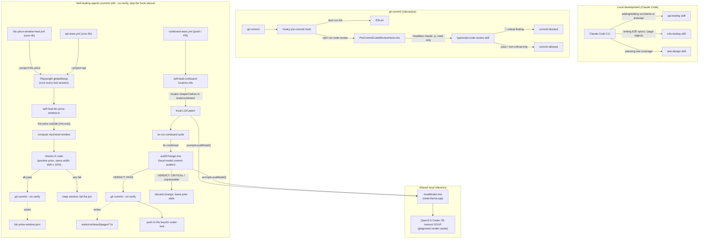

# cmc-tests

Automated API, contract, performance and end-to-end tests for [CoinMarketCap](https://coinmarketcap.com), written in TypeScript with Playwright and k6. Results from every run are reported to Allure and published on GitHub Pages.

## CoinBoard demo app

[CoinBoard](https://nknysh.github.io/cmc-tests/app/) is a small React app showing the top 100 coins from CoinMarketCap, built as a target for Playwright UI tests. It covers a market table with search, sorting, filters, paging and CSV export; coin detail pages with a price chart; and a converter, coin comparison, watchlist and portfolio. A daily workflow fetches one `listings/latest` snapshot (1 API credit) and publishes it as static JSON, so the API key never reaches the browser. A snapshot with any price of 0 or below is rejected whole and the last accepted one stays published; the app also falls back to that one if it ever loads an invalid price. Run it locally with `cd app && npm install && npm run dev`; it uses committed fixture data, so no key is needed.

CoinBoard is developed in four steps, each building on the one before:

1. **User story.** Each feature starts as a story with numbered acceptance criteria, in [`app/user-stories/`](app/user-stories/README.md). When a story describes behavior the app doesn't have yet, it lists it under "Known gaps", and open questions are recorded until someone decides them.
2. **Code.** The app in [`app/src/`](app/src) implements the stories. A change in behavior updates its story first.
3. **Test cases.** A story's test cases go in a `.test.md` file next to it, written for automation. Each case gives its preconditions, the exact data it uses and steps with checkable expected results, and covers named acceptance criteria.
4. **Autotests.** Each `.test.md` file becomes a Playwright spec in [`tests/coinboard/specs/`](tests/coinboard/specs), one test per case, with the same titles and severities.

So far the Compare stories (`CMP-01` to `CMP-03`) and the Converter stories (`CNV-01`, `CNV-02`) have test cases, and all five are automated, 100 tests in all. For example, `CMP-01` is automated as [`CMP-01-two-coins-can-be-compared.spec.ts`](tests/coinboard/specs/CMP-01-two-coins-can-be-compared.spec.ts).

### CoinBoard UI tests

The specs in `tests/coinboard/` run in their own Playwright project, `coinboard`:

- **Data:** every test serves the committed snapshot (or a stub built from it) as the app's data, so results don't depend on the live market and no API key is needed.
- **Page objects:** `tests/coinboard/pages/` holds one page object per page under test (`ComparePage`, `CoinPage`, `ConverterPage`), each provided to specs as a fixture.
- **Browser errors:** a test fails if the app throws an uncaught error or logs a `console.error`, even when every assertion passed. The errors are attached to the report.
- **DOM snapshot:** every failing test gets a compact snapshot of the page's DOM attached, which the locator self-heal uses as its input.
- **Dev server:** any run that includes the project starts the app's Vite dev server. To test a running or deployed app instead, set `COINBOARD_URL`.
- **CI:** the [CoinBoard UI Tests workflow](.github/workflows/coinboard-tests.yml) runs the whole project through the locator self-heal once a day and on pushes to `main` and pull requests that change its tests, the heal agents or the test config. It publishes the Allure report on every run except pull requests. The [CoinBoard Smoke Tests workflow](.github/workflows/coinboard-smoke-tests.yml) runs only the blocker and critical tests on pushes to `main` and pull requests that change the app (`npm run test:coinboard-smoke` locally).

## Allure reports

| Report | Link |
|---|---|
| Summary of all reports | https://nknysh.github.io/cmc-tests/ |
| API tests (simple price, quotes latest) | https://nknysh.github.io/cmc-tests/api/ |
| Contract tests | https://nknysh.github.io/cmc-tests/contract/ |
| BTC price window | https://nknysh.github.io/cmc-tests/btc-price/ |
| CoinBoard UI tests | https://nknysh.github.io/cmc-tests/coinboard/ |
| Performance baseline (k6) | https://nknysh.github.io/cmc-tests/perf/ |

Reports are regenerated by the CI workflows and served from the `gh-pages` branch. Each suite keeps its own run history (`allure-history/<suite>.jsonl` on that branch), so each report shows trends across its own runs only and never includes another suite's results.

Each suite also has an Allure quality gate (`allurerc.mjs`). It fails the run on any failed blocker or critical test, or on more than two failures among lower-severity tests. It also fails when the suite has fewer tests than it currently does, so a spec that silently drops out is caught. Every test declares its Allure severity (`tests/helpers/severity.ts`), so the reports can be filtered and grouped by it.

## Technologies

**Language and runtime**
- TypeScript (`typescript` is aliased to `@typescript/typescript6`; TypeScript 7 is installed alongside)
- Node.js 24+

**Testing**
- [Playwright Test](https://playwright.dev) for API specs (no browser) and browser UI specs against the CoinBoard app (Desktop Chrome)
- UI tests for the CoinBoard demo app, with stubbed snapshot data and a check that fails tests on browser errors
- Contract tests with [zod](https://zod.dev) schemas: live provider checks against the CoinMarketCap API, and offline consumer checks of the client against recorded fixtures
- [k6](https://grafana.com/docs/k6/) latency baseline for the CoinMarketCap API (not a load test: the Basic key allows 30 requests a minute)
- Page Object Model for the CoinBoard UI tests
- Typed HTTP clients for third-party APIs (CoinMarketCap client in `src/clients/`)

**Reporting**
- [Allure Report 3](https://allurereport.org) (`allure`) with `allure-playwright`
- Playwright HTML reporter and list reporter
- GitHub Pages for hosting reports

**Code quality**
- ESLint with typescript-eslint and eslint-plugin-playwright
- Husky pre-commit hook running lint and an AI code review (`claude -p` with the `typescript-code-review` skill)
- SonarQube Cloud static analysis on every push to `main`, every PR and on demand, failing the check when the quality gate fails

**CI/CD**
- GitHub Actions: six workflows, listed under [CI workflows](#ci-workflows)

**Self-healing agents**
- BTC price window: recentres the expected price range when the live price drifts outside it, after checks in code (positive price, unchanged width, a shift of at most 10%)
- CoinBoard locators: when the app's markup changes and a CoinBoard UI test can't find an element, repairs the page object using a local LLM (Qwen2.5-Coder-7B-Instruct GGUF via `node-llama-cpp`, no external API), re-runs the suite, has a second local-model pass audit the patch, and commits it to the branch under test

**AI tooling**
- Claude Code with project skills (`api-testing`, `e2e-testing`, `test-design`, `typescript-code-review`), global QA skills for designing, automating and debugging tests, and the Playwright MCP server (`@playwright/mcp`)

**Other**
- `dotenv` for environment configuration

## Setup

```bash
npm install
npx playwright install chromium
npm install --prefix app   # CoinBoard app dependencies, needed to run the CoinBoard UI tests
cp .env.example .env   # then set CMC_API_KEY (CoinMarketCap Pro API key)
```

## Commands

```bash
npm test                # all specs
npm run test:api        # API specs (simple price, quotes latest)
npm run test:contract   # contract specs (provider specs need CMC_API_KEY)
npm run test:btc-price  # BTC price window spec
npm run test:coinboard  # CoinBoard UI specs (starts the app's dev server)
npm run test:perf       # k6 latency baseline (needs the k6 binary and CMC_API_KEY exported)
npm run test:ui         # Playwright UI mode
npm run test:headed     # headed browser
npm run test:report     # open the last Playwright HTML report

npm run test:allure       # run each Playwright suite, then build its own Allure report (not perf)
npm run allure:api        # build allure-report/api/ from allure-results/api/
npm run allure:contract   # build allure-report/contract/
npm run allure:btc-price  # build allure-report/btc-price/
npm run allure:coinboard  # build allure-report/coinboard/
npm run allure:perf       # build allure-report/perf/
ALLURE_SUITE=api npm run allure:open  # open one suite's report
ALLURE_SUITE=api npm run allure:gate  # check one suite's results against its quality gate

npm run lint            # ESLint
npm run lint:fix        # ESLint with autofix
npx tsc --noEmit        # type-check
npm run code-review     # the pre-commit AI review of uncommitted TypeScript changes

npm run snapshot -- <outDir> [previousHistory]  # write a CoinBoard snapshot (1 API credit, needs CMC_API_KEY)
```

## CI workflows

| Workflow | When it runs | What it does |
|---|---|---|
| [API Tests](.github/workflows/api-tests.yml) | daily at 01:30 UTC, on demand | Contract specs, then API specs, each under its own Allure quality gate; publishes both reports |
| [BTC price window heal](.github/workflows/btc-price-window-heal.yml) | every 4 hours, on demand | Runs the BTC price spec, whose global setup recentres the price window, and pushes the commit if it changed |
| [Performance baseline](.github/workflows/perf-tests.yml) | daily at 03:15 UTC, on demand | k6 latency baseline; publishes the Allure report and posts the results table as the job summary |
| [CoinBoard UI Tests](.github/workflows/coinboard-tests.yml) | daily at 04:00 UTC, pushes to `main` and PRs touching the CoinBoard tests, heal agents or test config, on demand | All CoinBoard UI specs through the locator self-heal; pushes any heal commit to the branch under test |
| [CoinBoard Smoke Tests](.github/workflows/coinboard-smoke-tests.yml) | pushes to `main` and PRs touching the app, on demand | Blocker and critical CoinBoard UI specs only, selected by severity tag; publishes its own Allure report except on PRs |
| [CoinBoard App](.github/workflows/app-deploy.yml) | daily at 06:00 UTC, pushes to `main` touching the app or its data script, on demand | Takes a fresh snapshot, builds the app and publishes it to GitHub Pages |
| [SonarQube Cloud](.github/workflows/sonar.yml) | pushes to `main`, every PR, on demand | Static analysis with the ESLint report imported; fails when the quality gate fails |

Every workflow that publishes to `gh-pages` shares one concurrency group, so they never push to it at the same time.

## Test case viewer

A read-only web UI for browsing the test cases database (`data/test-cases.db`): a collapsible suite tree, the tests in each suite, and a detail view for each test case (description, preconditions, steps). Suites and test cases are shown with their IDs (`#<id> <name>`), and test cases without a suite appear under "Unsorted".

```bash
npm install     # first time only
npm run viewer  # then open http://127.0.0.1:4000
```

Stop it with `Ctrl+C`. The server only listens on `127.0.0.1`. Restart it after editing `index.html`, since the page is read once at startup.

| Env var | Default | Purpose |
|---|---|---|
| `PORT` | `4000` | Port to listen on |
| `TEST_CASES_DB` | `data/test-cases.db` | Path to the SQLite database file |

Test case URLs are shareable, e.g. `http://127.0.0.1:4000/#case/2` (also `#suite/<id>` and `#unsorted`).

## Agents, skills & hooks



- **Skills** (`api-testing`, `e2e-testing`, `test-design`, `typescript-code-review`) are conventions Claude Code loads for a matching task — the first three during interactive development, the last one only inside the headless review invoked by the pre-commit hook.
- **Hooks**: the Husky `pre-commit` hook is the only one wired into `git commit` directly; it runs lint then `PreCommitCodeReviewHook.mts`, which blocks on 🔴 critical findings from the `typescript-code-review` skill. Both self-heal agents deliberately bypass it (`--no-verify`) since they avoid the paid `claude -p` call this hook makes.
- **Agents**: the BTC price window heal runs on every Playwright run via `globalSetup`, including its own and the API-tests cron workflows. Its recentring is gated by checks in code; it used to go through the local-model auditor, which got the arithmetic wrong and blocked valid recentrings. The CoinBoard locator heal runs inside the CoinBoard UI tests workflow. When every failure is a broken locator, it gets a local-LLM patch of the page object, verified by re-running the suite, then audited by `auditChange.mts` before committing to the branch under test. Any other failure is left for a human. Patch generation and the audit both call the same `localModel.mts` helper, which drives the shared, gitignored GGUF model, downloaded only when a heal is attempted.

## Project layout

```
app/                   CoinBoard demo app (src/, user-stories/ with stories and test cases)
scripts/               CoinBoard snapshot script
src/clients/           typed API clients (CoinMarketCap)
src/db/testCases/      SQLite test case store
src/web/testCaseViewer/ test case viewer (server + page)
data/                  test case database
tests/api/             API specs
tests/contract/        contract specs (provider, consumer, fixtures)
tests/coinboard/       CoinBoard UI specs, page objects, fixtures and snapshot stubs
tests/helpers/         shared test helpers (CMC client factory, severity, test case ids)
tests/perf/            k6 latency baseline
.agents/               self-healing agents, their auditor and the pre-commit review hook
.claude/skills/        project skills for Claude Code
.github/workflows/     CI workflows
.github/allure-summary/ landing page for the published Allure reports
allurerc.mjs           Allure configuration and quality gates
```

See [CLAUDE.md](CLAUDE.md) for detailed conventions and architecture.
